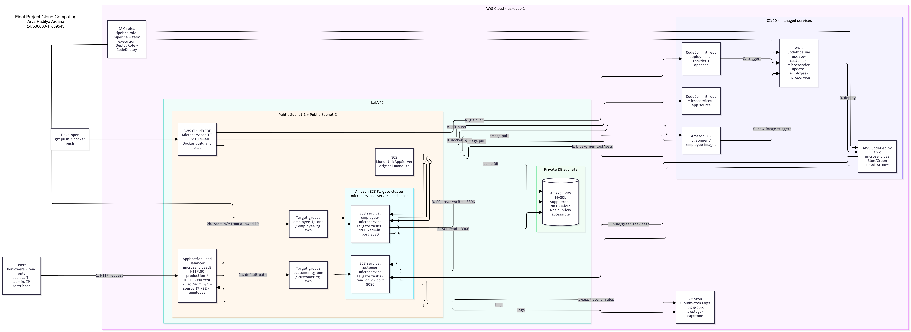

# Building Microservices and a CI/CD Pipeline with AWS

Arya Raditya Ardana · NIU 24/536660/TK/59543 · Cloud Computing Final Project

A monolithic Node.js supplier directory (use case: Lab Equipment Supplier Directory) split into two Docker microservices and deployed on Amazon ECS Fargate behind an Application Load Balancer, with blue/green CI/CD through CodePipeline and CodeDeploy. Track B – Containers.

## Architecture



- **customer** – read-only supplier list (`/`, `/suppliers`), port 8080
- **employee** – full CRUD under `/admin/*`, port 8080, restricted to the admin IP at the ALB
- Both services share Amazon RDS MySQL `supplierdb` (database `COFFEE`, table `suppliers`)
- ALB `microservicesLB`: HTTP:80 production, HTTP:8080 test; `/admin/*` routes to employee
- CI/CD: CodeCommit + ECR → CodePipeline → CodeDeploy (blue/green, ECSAllAtOnce)

## Repository structure

| Branch / path | Contents |
| --- | --- |
| dev: README.md | This file |
| dev: docs/ | architecture.png, architecture.drawio, cost-estimate.pdf |
| dev: customer/ | Read-only microservice + Dockerfile |
| dev: employee/ | CRUD microservice under /admin + Dockerfile |
| deployment: taskdef-\*.json | ECS Fargate task definitions (IMAGE1_NAME placeholder) |
| deployment: appspec-\*.yaml | CodeDeploy AppSpec files |
| deployment: create-\*-tg-two.json | ECS service definitions |
| deployment: dg-\*.json | CodeDeploy deployment group configs |

## CRUD endpoints

| Operation | Method and path | Service |
| --- | --- | --- |
| Create | POST /admin/supplier-add | employee |
| Read | GET /admin/suppliers, GET /admin/supplier-update/:id | employee |
| Update | POST /admin/supplier-update | employee |
| Delete | POST /admin/supplier-remove/:id | employee |
| Read (public) | GET /suppliers | customer |

## Run locally (Docker)

```bash
cd customer && docker build -t customer .
docker run -d --name customer_1 -p 8080:8080 -e APP_DB_HOST=<rds-endpoint> customer

cd ../employee && docker build -t employee .
docker run -d --name employee_1 -p 8081:8080 -e APP_DB_HOST=<rds-endpoint> employee
```

## Deployment plan

1. Build and test each image in Cloud9.
2. Tag and push images to ECR repositories `customer` and `employee`.
3. Register task definitions; create ECS services with the CODE_DEPLOY controller.
4. Create 4 target groups and `microservicesLB` with listeners 80/8080 and `/admin/*` rules.
5. Create CodeDeploy application `microservices` with two blue/green deployment groups.
6. Create pipelines `update-customer-microservice` and `update-employee-microservice` (source: CodeCommit `deployment` + ECR image; deploy: ECS Blue/Green).
7. Release by pushing a new image to ECR or committing to `deployment`.

## Cost estimate

About 86.44 USD per month, 1,037.28 USD per 12 months in us-east-1. Details: `docs/cost-estimate.pdf` and the [AWS Pricing Calculator estimate](https://calculator.aws/#/estimate?id=2a5456ea0e4f1adbf5dea6b497cdf9a3b2970b0a).
